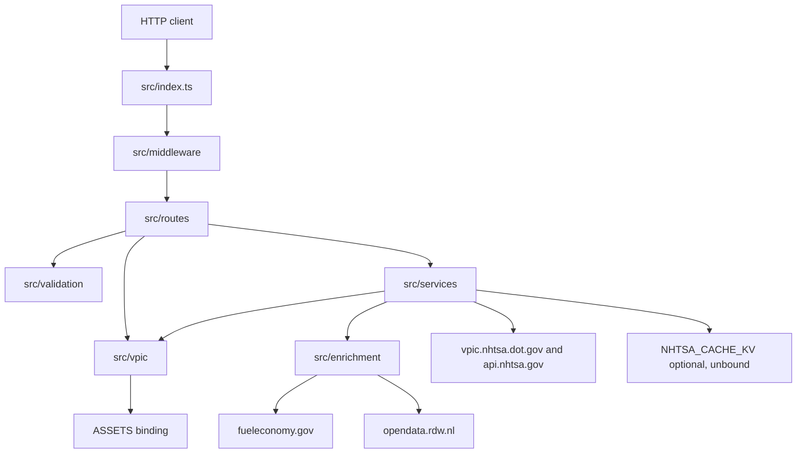
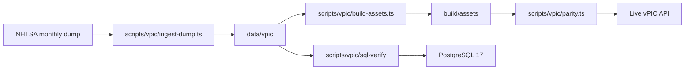

# Architecture

Current layout of `nhtsa-edge-api` on `main`, plus the target module boundaries. Directories below exist in the tree. Items under **Target** are not built yet.

The Worker (Hono) serves https://data.ai-kit.net. VIN decode runs offline from git-tracked vPIC tables. Other NHTSA endpoints are proxied. EPA and RDW data are model-level lookups on `/api/v1/vin/:vin/unified`.

## Request path

Dependency direction is downward in that diagram. `src/vpic` does not import `src/routes`, `src/services`, or `src/enrichment`. `src/enrichment` does not import the decoder or the routers. `src/validation` depends only on Zod.

## Modules

| Module | Path | Responsibility | Talks to |
| :-- | :-- | :-- | :-- |
| platform | `src/index.ts`, `src/middleware/`, `src/config.ts`, `src/types/`, `wrangler.jsonc` | Worker entry, CORS, timing, errors, constants, the `Env` bindings | mounts `routes` |
| routes | `src/routes/` | HTTP: health and HTML, v1 API, vPIC drop-in, recalls proxy | `vpic`, `services`, `validation`, `config`, `types` |
| vpic | `src/vpic/` | Offline port of NHTSA `spVinDecode` and the response shapes | `ASSETS` only |
| services | `src/services/` | Upstream fetch, Cache API / optional KV, unified profile assembly | `enrichment`, `vpic` types, `config`, `types` |
| enrichment | `src/enrichment/` | Adapters for FuelEconomy.gov and RDW Open Data | those HTTP APIs |
| validation | `src/validation/vin.ts` | VIN and model-year parsing at the trust boundary | Zod |
| pipeline | `scripts/vpic/` | Ingest, asset build, live parity, SQL verification, errata audit | filesystem, NHTSA downloads, live vPIC API, PostgreSQL 17 |
| data | `data/vpic/` | Git-tracked vPIC tables and `manifest.json` | read by the pipeline; the Worker reads the built assets |
| docs | `docs/` | Data pipeline, NHTSA errata, verbatim SQL reference, this map, status | none at runtime |

`test/` is Vitest against the real built assets. It is not a product module. `scripts/cloudflare/check.ts` is a read-only ops check used by `.github/workflows/cloudflare-check.yml`. It is not on the request path.

### routes

| Path | Role |
| :-- | :-- |
| `src/routes/health.ts` | `GET /` (HTML hub for browsers, health JSON for API clients), `GET /health`, `GET /vpic` |
| `src/routes/landing/` | Hub catalog (`hub.ts`) and the VIN page (`vpic.ts`). Public exports are `landing/index.ts` |
| `src/routes/v1/` | `/api/v1/vin/:vin`, `/unified`, `/compare`, `/makes`, `/models`, `/recalls/:vin` |
| `src/routes/vpic-decode.ts` | Offline `DecodeVin`, `DecodeVinValues`, and `DecodeVINValuesBatch` |
| `src/routes/vpic-proxy.ts` | Every other `/vehicles/*` call, proxied and cached. `*Extended` stays upstream |
| `src/routes/recalls-proxy.ts` | `/recalls/*` drop-in proxy |

### vpic

One file per step of the port. Outside the module, callers use:

| Entry | File |
| :-- | :-- |
| `decodeVin` | `decode.ts` |
| `toDecodeVinValues`, `toDecodeVinVariables`, `vpicEnvelope` | `format.ts` |
| `toV1Spec` | `v1-format.ts` |
| `getVpicStore` | `worker-store.ts` |

`decode-core.ts`, `decode-errors.ts`, `keys.ts`, `vin-functions.ts`, `vehicle-spec.ts`, `conversions.ts`, `tsql-decimal.ts`, `items.ts`, `store.ts`, and `bounded-cache.ts` are internal to the port.

### services and enrichment

| Entry | File | Role |
| :-- | :-- | :-- |
| `fetchUpstream` | `services/upstream.ts` | NHTSA HTTP with timeout and retries |
| `serveCachedUpstream` | `services/cached-upstream.ts` | Cache API, then optional KV |
| `resolveUnifiedVehicle` | `services/multi-source-resolver.ts` | Offline spec plus EPA and RDW |
| `fetchEpaEnergySpecs` | `enrichment/epa.ts` | https://www.fueleconomy.gov/ws/rest |
| `fetchRdwEuropeanSpecs` | `enrichment/rdw.ts` | https://opendata.rdw.nl/resource/m9d7-ebf2.json |

A failed enrichment leaves its section null. The decode does not depend on it.

### Platform bindings

From `src/types/env.ts` and `wrangler.jsonc`:

| Binding | State | Use |
| :-- | :-- | :-- |
| `ASSETS` | Required. `run_worker_first: true` | Decoder JSON built from `data/vpic` into `build/assets` |
| `NHTSA_CACHE_KV` | Unbound. `ENABLE_KV_CACHE` is `false` | Optional cache for proxied responses |
| vars | `ENVIRONMENT`, `UPSTREAM_TIMEOUT_MS` | Health and upstream timeout |
| routes | `data.ai-kit.net` on production; `env.dev` clears routes | Custom domain. `workers_dev` stays on |

`env.dev` is the Worker `nhtsa-edge-api-dev`, deployed by `.github/workflows/vpic-data.yml`.

## Data pipeline

Not imported by the Worker. `docs/DATA.md` is the procedure.

`docs/vpic-reference/decode-functions.sql` is NHTSA's SQL, kept as the porting reference. `scripts/vpic/errata/audit.ts` checks the defects in `docs/NHTSA-ERRATA.md`.

## External services

| Service | Used by | When |
| :-- | :-- | :-- |
| `vpic.nhtsa.dot.gov` downloads | `scripts/vpic` | Weekly ingest |
| `vpic.nhtsa.dot.gov/api` | `services/upstream.ts`, `scripts/vpic/parity.ts` | Proxied endpoints and the parity gate |
| `api.nhtsa.gov` | recalls routes | Recalls proxy, cached 6 hours |
| FuelEconomy.gov | `enrichment/epa.ts` | `/unified` |
| RDW Open Data | `enrichment/rdw.ts` | `/unified` |
| Cloudflare Workers | the Worker | Runtime, static assets, optional KV |
| PostgreSQL 17 | `scripts/vpic/sql-verify` | CI and local verification only |

## In flight, not on main

Pull request #5 (`claude/exciting-pascal-8khdrj`) adds rate limiting, OpenAPI, a batch page, and `docs/COMPARISON.md`. Those files are not in this tree. Do not document them as modules until that pull request merges.

## Target boundaries

The modules above stay. The gap is how they are imported, not a missing framework.

Today `src/routes` reaches into `src/vpic/decode.ts`, `format.ts`, `v1-format.ts`, `worker-store.ts`, and `types.ts`. `src/services/multi-source-resolver.ts` reaches into `src/enrichment/epa.ts`, `rdw.ts`, and `src/vpic/v1-format.ts`.

Target, when the next change already touches that edge:

- Callers outside `src/vpic` use one public entry for decode, formats, and the store. Files that implement a single SQL step stay internal.
- Callers outside `src/enrichment` use one public entry. `epa.ts` and `rdw.ts` stay the adapters.
- A new external lookup is another adapter beside those two. A new dataset with its own stored tables and decode path is its own domain module, the way `vpic` is, with its own pipeline directory. It gets an `area:<module>` label when it exists.

Do not add that entry-point file, or an interface with one implementation, ahead of the change that needs it.

Planned datasets (hub and `HANDOFF.md`), still without a module:

| Dataset | Where it is named | Likely home once built |
| :-- | :-- | :-- |
| Offline safety recalls | hub status `partial` | domain module plus `scripts/` pipeline, same shape as vPIC |
| Full EPA / DOE fuel economy | hub status `partial` | extend `enrichment` if it stays a lookup; own module if the tables are bundled |
| Complaints and NCAP ratings | hub status `planned` | same choice as fuel economy |
| UK DVSA MOT, Australian Green Vehicle Guide, Euro NCAP | `HANDOFF.md` | `enrichment` adapters |
